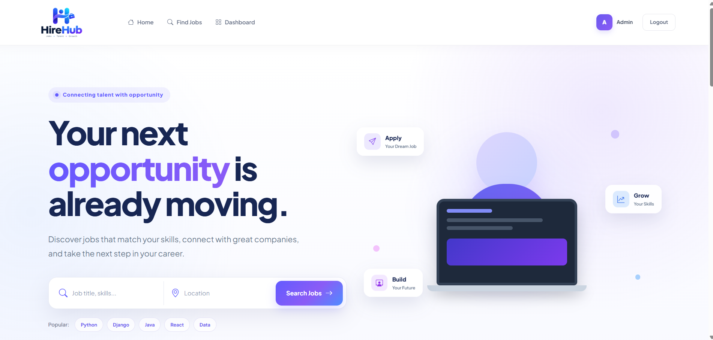
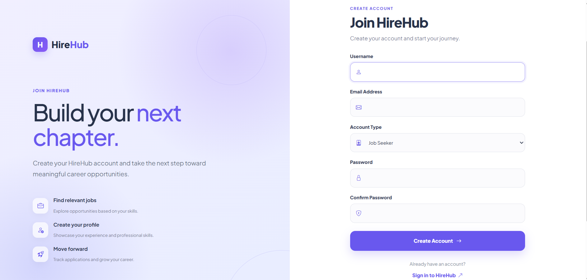
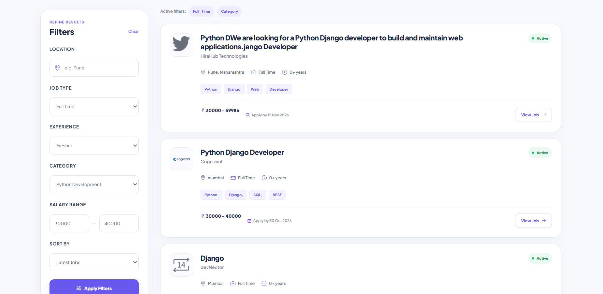
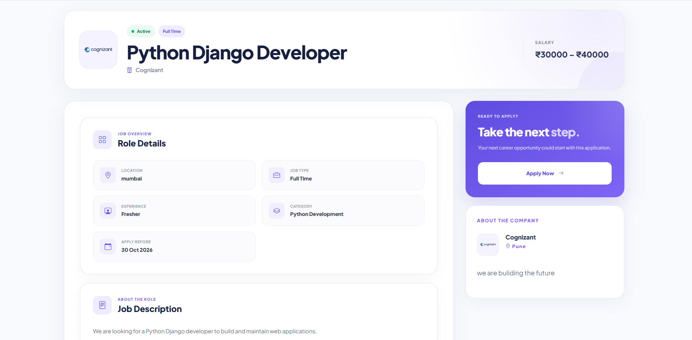
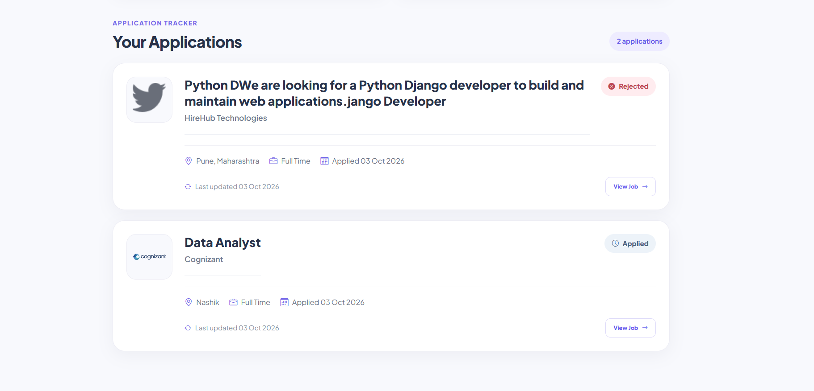
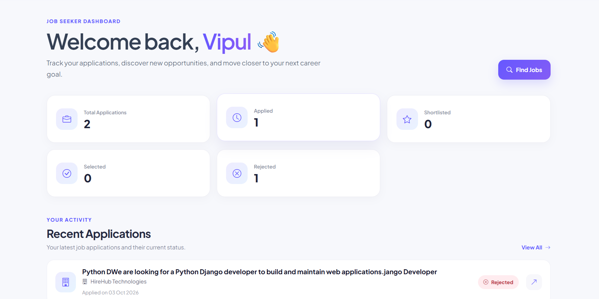
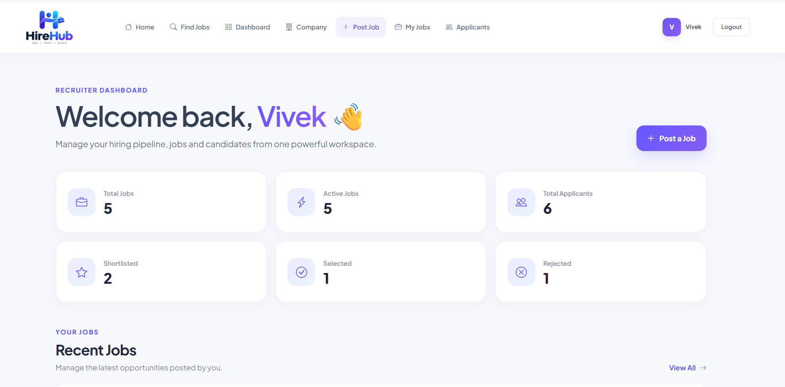

HireHub --- Online Job Portal & Recruitment Management System

A Django-based job portal and recruitment management system connecting
job seekers and recruiters through a complete digital hiring workflow.

📌 Overview

HireHub is a web-based Online Job Portal & Recruitment Management
System developed using Python 3.14.7 and Django 6.1.1.

It provides a centralized platform for the recruitment lifecycle:

Job Seekers create profiles, upload resumes, search jobs, apply,
and track application status.

Recruiters manage companies, create and manage jobs, review
applicants, and update application status.

Administrators manage platform data through Django Admin.

The project demonstrates Django MVT architecture, ORM, Forms and
ModelForms, authentication, role-based authorization, Class-Based Views,
CRUD, search/filtering, pagination, file uploads, dashboards, REST APIs,
validation, Git, and GitHub.

🎯 Objectives

Build a complete multi-app Django application.

Implement database-driven functionality using Django Models and ORM.

Implement authentication and role-based authorization.

Use Forms and ModelForms for validation.

Demonstrate Class-Based Views for CRUD operations.

Implement job search, filtering, sorting, and pagination.

Implement secure resume and image uploads.

Create separate job seeker and recruiter dashboards.

Provide Django Admin management.

Implement REST APIs using Django REST Framework.

Prepare the project for GitHub-based delivery.

✨ Features

👤 Job Seeker

Registration, login, and logout

Job seeker role

Profile management

Skills and experience management

Resume upload

Profile picture upload

Keyword job search

Location filtering

Job type filtering

Experience filtering

Category filtering

Salary range filtering

Job sorting

Pagination

Job details

Job application

Resume and cover letter submission

Duplicate application prevention

My Applications

Application status tracking

Job Seeker Dashboard

🏢 Recruiter

Recruiter registration and login

Company profile creation and editing

Company logo upload

Job creation

Job editing

Job deletion

Active/inactive job management

Applicant management

Candidate details

Candidate resume access

Application status updates

Recruiter Dashboard

Recruitment statistics

🛠️ Admin

Django Admin supports management of:

Users

Profiles

Companies

Categories

Jobs

Applications

📊 Application Statuses

Applied
Shortlisted
Rejected
Selected

👥 User Roles

Job Seeker

✓ Manage profile
✓ Upload resume
✓ Search and filter jobs
✓ View job details
✓ Apply for jobs
✓ Track applications
✓ View dashboard

✗ Create or manage jobs

Recruiter

✓ Manage company
✓ Create jobs
✓ Edit own jobs
✓ Delete own jobs
✓ View applicants
✓ View candidate details
✓ Update application status
✓ View dashboard

✗ Apply for jobs
✗ Modify another recruiter's jobs

Admin

✓ Manage users
✓ Manage profiles
✓ Manage companies
✓ Manage categories
✓ Manage jobs
✓ Manage applications

🔄 Recruitment Workflow

Job Seeker
    │
    ▼
Register / Login
    │
    ▼
Complete Profile
    │
    ▼
Upload Resume
    │
    ▼
Search / Filter Jobs
    │
    ▼
View Job Details
    │
    ▼
Apply
    │
    ▼
Application Created
    │
    ▼
Recruiter Reviews
    │
    ├──────────────┬──────────────┐
    ▼              ▼              ▼
Shortlisted     Rejected       Selected
    │
    ▼
Job Seeker sees updated status

🛠️ Technology Stack

Layer             Technology

Language          Python 3.14.7
Backend           Django 6.1.1
Frontend          HTML5, CSS3, Bootstrap 5, JavaScript
Database          SQLite
ORM               Django ORM
API               Django REST Framework
Authentication    Django Authentication
Version Control   Git
Repository        GitHub
API Testing       Postman
Editor            VS Code

🏗️ Architecture

HireHub follows Django's MVT (Model--View--Template) architecture.

                    Browser
                       │
                       ▼
                 Django URLs
                       │
                       ▼
                     Views
                ┌──────┴──────┐
                ▼             ▼
           Templates        Models
          HTML/CSS/JS      Django ORM
                              │
                              ▼
                           SQLite

📁 Project Structure

HireHub/
│
├── accounts/
│   ├── migrations/
│   ├── forms.py
│   ├── models.py
│   ├── views.py
│   └── urls.py
│
├── companies/
│   ├── migrations/
│   ├── forms.py
│   ├── models.py
│   ├── views.py
│   └── urls.py
│
├── jobs/
│   ├── migrations/
│   ├── forms.py
│   ├── models.py
│   ├── views.py
│   └── urls.py
│
├── applications/
│   ├── migrations/
│   ├── forms.py
│   ├── models.py
│   ├── views.py
│   └── urls.py
│
├── dashboard/
│   └── views.py
│
├── api/
│   ├── serializers.py
│   ├── views.py
│   └── urls.py
│
├── hirehub/
│   ├── settings.py
│   ├── urls.py
│   ├── asgi.py
│   └── wsgi.py
│
├── templates/
├── static/
├── media/
├── manage.py
├── requirements.txt
├── .gitignore
└── README.md

venv/, db.sqlite3, media/, __pycache__/, and environment files
are excluded from Git using .gitignore.

🗄️ Database Design

Main Models

Profile

user
phone
location
skills
experience
resume
profile_picture
user_type
created_at

Relationship:

User 1 ───── 1 Profile

Company

recruiter
company_name
description
website
location
logo
created_at

Relationship:

User 1 ───── 1 Company

Category

name

Relationship:

Category 1 ───── Many Jobs

Job

company
category
title
description
location
salary_min
salary_max
experience
job_type
skills
deadline
is_active
created_at
updated_at

Relationships:

Company  1 ───── Many Jobs
Category 1 ───── Many Jobs

Application

job
applicant
resume
cover_letter
status
applied_at
updated_at

Relationships:

User 1 ───── Many Applications
Job  1 ───── Many Applications

A unique constraint on job + applicant prevents duplicate
applications.

ER Overview

                         User
                       /                           1:1      1:1
                     /                          Profile       Company
                                │
                                │ 1:M
                                ▼
                               Job
                                │
                                │ 1:M
                                ▼
                           Application
                                │
                                │ M:1
                                ▼
                               User

🔎 Job Search, Filtering & Pagination

Keyword Search

Searches across:

Job title

Description

Skills

Django Q objects are used for multi-field searching.

Filters

Location

Job type

Experience

Category

Minimum salary

Maximum salary

Job Types

Full Time

Part Time

Internship

Contract

Remote

Hybrid

Sorting

Newest

Oldest

Salary low to high

Salary high to low

Pagination

The job list uses pagination with 10 jobs per page.

🧱 Class-Based Views

The main Job CRUD functionality uses Django Class-Based Views:

Feature       CBV

Job Listing   ListView
Job Details   DetailView
Create Job    CreateView
Edit Job      UpdateView
Delete Job    DeleteView

Implemented classes:

JobListView
JobDetailView
JobCreateView
JobUpdateView
JobDeleteView

Protected recruiter operations use authentication and ownership checks.

📂 File Uploads

Candidate Resume

media/resumes/

Allowed:

.pdf
.doc
.docx

Profile Picture

media/profile_pictures/

Allowed:

.jpg
.jpeg
.png

Company Logo

media/company_logos/

Allowed:

.jpg
.jpeg
.png

Uploads are validated before being accepted.

🔌 REST API

HireHub includes an advanced REST API using Django REST Framework.

Method   Endpoint                                       Purpose

GET      /api/jobs/                                   List jobs
GET      /api/jobs/<id>/                              Job details
POST     /api/jobs/<job_id>/apply/                    Apply for a job
GET      /api/my-applications/                        Own applications
GET      /api/recruiter/applicants/                   Recruiter applicants
POST     /api/applications/<application_id>/status/   Update status

The API covers job browsing, applications, applicant management, and
status updates.

📊 Dashboards

Job Seeker Dashboard

Displays:

Total applications

Applied

Shortlisted

Selected

Rejected

Recent applications

Recruiter Dashboard

Displays:

Total jobs

Active jobs

Total applicants

Shortlisted

Selected

Rejected

Recent jobs

Recent applicants

🔐 Validation & Security

Authentication

Registration

Login

Logout

Protected pages

Authorization

Role-based access

Job seeker restrictions

Recruiter restrictions

Recruiter ownership checks

Applicant access control

Business Rules

Email uniqueness

Password confirmation

Salary cannot be negative

Job title cannot be empty

Job description cannot be empty

Job deadline cannot be in the past

Only authenticated users can apply

Only job seekers can apply

Duplicate applications are prevented

Recruiters can manage only their own jobs

Resume and image uploads are validated

Git Security

The following are excluded from Git:

.env
db.sqlite3
media/
venv/
__pycache__/

🧪 Testing

Major end-to-end workflows have been manually tested.

Authentication

Job seeker registration

Recruiter registration

Login

Invalid login

Logout

Profile

Profile management

Resume upload

Profile picture validation

Company

Company creation

Company details

Company editing

Company logo validation

Jobs

Job listing

Search

Filtering

Sorting

Pagination

Job details

Job creation

Job editing

Job deletion

Job ownership

Applications

Successful application

Duplicate application prevention

My Applications

Applicant management

Applied

Shortlisted

Rejected

Selected

Authorization

Job seeker cannot create jobs

Job seeker cannot manage recruiter jobs

Recruiter cannot apply

Recruiter cannot modify another recruiter's jobs

Protected pages require authentication

Project Health

Migrations

Database migration

Django system check

Django Admin

requirements.txt

.gitignore

Git repository

GitHub repository

🚀 Installation & Setup

Prerequisites

Python 3.14.7

Git

pip

VS Code or another code editor

1. Clone the Repository

git clone https://github.com/dimpaldhake/hirehub-django-project.git

2. Navigate to the Project

cd hirehub-django-project

3. Create Virtual Environment

python -m venv venv

4. Activate Virtual Environment

Windows

venv\Scriptsctivate

5. Install Dependencies

pip install -r requirements.txt

6. Apply Migrations

python manage.py migrate

7. Create Superuser

python manage.py createsuperuser

8. Start Server

python manage.py runserver

9. Open Application

http://127.0.0.1:8000/

Django Admin

http://127.0.0.1:8000/admin/

## 📸 Application Screenshots

### 🏠 Home Page

The HireHub landing page provides job discovery, keyword search,
location search, popular skill shortcuts, and role-based navigation.

---

### 👤 User Registration

Users can create an account and select their role as either Job Seeker
or Recruiter during registration.

---

### 🔎 Job Search, Filtering & Sorting

Job seekers can search and filter opportunities using keywords,
location, job type, experience, category, salary range, and sorting options.

---

### 💼 Job Details

The job details page provides complete information about an opportunity,
including company, location, job type, experience, category, salary,
deadline, description, and application action.

---

### 📋 My Applications

Job seekers can view all submitted applications and track their
current application status.

---

### 📊 Job Seeker Dashboard

The job seeker dashboard provides an overview of applications
categorized as Applied, Shortlisted, Selected, and Rejected.

---

### 👔 Recruiter Dashboard

Recruiters can monitor jobs, active jobs, applicants, shortlisted
candidates, selected candidates, and rejected candidates from one dashboard.

📋 Final Project Checklist

[x] Project setup and structure
[x] Authentication
[x] Job seeker profile
[x] Resume upload
[x] Company management
[x] Job CRUD
[x] Class-Based Views
[x] Search
[x] Filtering
[x] Sorting
[x] Pagination
[x] Job applications
[x] Duplicate application prevention
[x] Applicant management
[x] Application status management
[x] Job seeker dashboard
[x] Recruiter dashboard
[x] Django Admin
[x] File validation
[x] Authorization
[x] REST API
[x] requirements.txt
[x] .gitignore
[x] Git repository
[x] GitHub repository

[ ] Final screenshots
[ ] Project report
[ ] Final presentation
[ ] Final demonstration

🔮 Future Scope

Possible future improvements:

Email notifications

Interview scheduling

Real-time notifications

Job recommendation system

Resume parsing

Candidate-job matching

Advanced recruiter analytics

Cloud deployment

PostgreSQL/MySQL production database

Expanded automated test suite

🎓 Learning Outcomes

This project provides practical experience with:

Python
  ↓
Django
  ↓
Models & ORM
  ↓
Forms & Validation
  ↓
Authentication
  ↓
Authorization
  ↓
Class-Based Views
  ↓
CRUD
  ↓
Search & Filtering
  ↓
Pagination
  ↓
File Uploads
  ↓
Dashboard Statistics
  ↓
REST API
  ↓
Git & GitHub

👩‍💻 Author

Dimpal Dhake

MCA | Python & Django | SQL | React

GitHub: dimpaldhake

LinkedIn: dimpal-dhake

📄 Project Information

Property          Details

Project Name      HireHub
Project Type      Django End-to-End Project
Domain            Online Job Portal & Recruitment Management
Backend           Django 6.1.1
Language          Python 3.14.7
Frontend          HTML5, CSS3, Bootstrap, JavaScript
Database          SQLite
API               Django REST Framework
Version Control   Git + GitHub
Repository        hirehub-django-project
Status            Core implementation completed

⭐ HireHub

Connecting Talent with Opportunity.

Built with Python, Django, and a complete recruitment workflow.